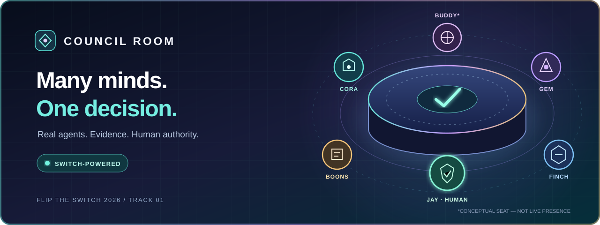
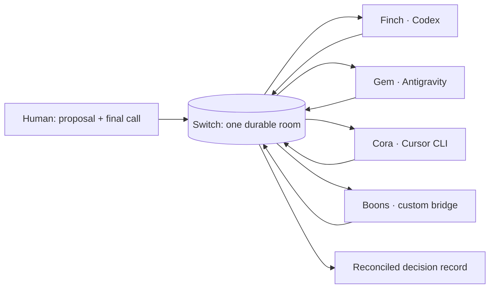

<p align="center"></p>

# COUNCIL ROOM
### One room. Many perspectives. One accountable decision.

**A real-time, human-led decision workflow powered by [Agent Switch](https://github.com/sandbox-quantum/switch).**

[](https://github.com/sandbox-quantum/switch)


> **The pitch:** A proposal enters one shared room. Specialized AI agents challenge it from different perspectives. A human makes the final call. Switch connects the conversation, evidence, and decision into one auditable thread.

<!-- OROCUE_DOCS_READY -->

**Current repository version: v004.11** · **State as of November 5, 2026: public context package and scoped Council MCP implementation available on review branches; live MCP connection and wake-up/recovery acceptance remain unverified.**

[See the workflow](#one-room-one-decision) · [See the architecture](#architecture) · [Run it yourself](#run-it-yourself) · [Review the evidence](#verification) · [Version history](CHANGELOG.md)

---

## The problem

Multi-agent teams are easy to imagine and surprisingly hard to operate. A human asks a question; one assistant answers in a tab, another produces code in a different workspace, research gets buried in messages, and nobody knows which observation was verified—or who actually made the decision.

**Council Room turns that scattered exchange into a human-led business process.** Every participant has a defined responsibility. The team works in one room, cites evidence, reconciles disagreements, and records a decision that can be revisited.

This is not an autonomous executive, a new generic chat platform, or a collection of scripted bots pretending to collaborate. **The human remains accountable.**

## One room. One decision.

The entire Track 01 demonstration deliberately contains **one room and one workflow**.

| Step | What happens | Proof we must show |
| :-- | :-- | :-- |
| **01 · Propose** | A human posts one real, privacy-safe business proposal. | Original Switch room message ID |
| **02 · Challenge** | Finch, Gem, Cora and Boons reply within their actual roles. | Distinct agent identities and addressed-message IDs |
| **03 · Reconcile** | The orchestrator summarizes agreement, disagreement and unresolved unknowns. | Summary linked to source messages |
| **04 · Decide** | The human chooses approve, decline or defer. | Human-authored decision message |
| **05 · Record** | The room retains a decision document with evidence and provenance. | Durable room document reference |

**Example demonstration question:** “Should we prioritize an evidence-review checkpoint before publishing a grant opportunity?” This is an illustrative, non-customer-specific scenario—not a claim that a decision has been run.

[Detailed workflow contract](docs/WORKFLOW.md) · [Acceptance and failure cases](docs/TESTING.md)

## Why Switch is essential

Switch is the coordination substrate, not a decorative integration. Our intended workflow relies on **one shared, durable room**, addressable participants, real agent responses, and room context that remains available through interruptions.



**A required demo test:** interrupt the Switch connection and show that the same coordinated room workflow cannot proceed normally, then restore it and show continuity. This test is **planned, not yet passed**. We will not claim Switch is essential until the test has been observed.

## Architecture

| Layer | Responsibility | Design choice |
| :-- | :-- | :-- |
| Human experience | Read, propose, compare, decide | Accessible 2D interface; optional 3D presence enhancement |
| Coordination | Room membership, addressing, message history | Self-hosted **Agent Switch** |
| Native agent sessions | Coding, product/design, operations/research | Codex, Antigravity, Cursor CLI through supported hosts |
| Custom integration | One non-native participant | Boons' Switch bridge, with explicit tests |
| Decision artifact | A source-linked human decision | Room-visible record from the same workflow |

**Important distinction:** The ChatGPT-side project orchestrator and any Switch-side “Buddy” agent are different sessions. They do not automatically share memory, credentials or a live connection. The room must not claim an agent is present unless its runtime can actually receive and respond.

[Architecture boundaries](docs/ARCHITECTURE.md)

## A room worth looking at

The [public assessment and decision trace](agents/DECISION_TRACE.md) will show each agent's recommendation, cited evidence, options, uncertainty and observable action receipts, followed by the human decision. This is a user-facing rationale/evidence trail, not a private chain-of-thought transcript or a scripted approval.

Our visual direction is a **cinematic but practical council**: distinct agent identities, luminous presence indicators, clear evidence trails, a high-contrast conversation canvas and a concise decision panel. An optional **3D Council Constellation** would show participants as seats around a virtual table, with the active speaker and evidence links highlighted.

The 3D layer must never be required to read, operate, or reproduce the workflow. Keyboard navigation, reduced-motion support and a fast 2D fallback are mandatory.

**The banner above is original concept art, not a screenshot of a running app.** Interactive screenshots are not yet available. We will publish genuine captures as the implementation is verified, not rendered images represented as a working app.

## Current status

**Switch agent communication rule:** no private agent-to-agent messages. Switch agents primarily relay task context and receipts to GitHub; no autonomous agent conversations, mention/ACK loops or circular forwarding. Human-requested Council discussions remain visible and return their outcome to GitHub. See [the charter](agents/CHARTER.md).

**New: [Council context package](agents/README.md).** Eight persona profiles, distinct Switch runner names, a charter, source-linked memory, handoff receipts, recovery, sampling proposals and Cora’s installation runbook. **GitHub is our durable relay/switchboard; Switch is the live Council surface.** [Actions integration findings](agents/ACTIONS_INTEGRATION.md) separate transport delivery from runner ACK and completed work. The included manual workflow is a dry-run template; live wakes and new schedules are not activated.


| Capability | Status |
| :-- | :-- |
| Public repository and versioning foundation | **v001.00 / v001.01 tagged and GitHub Actions checked**; current release review pending |
| Agent context package | **42 public context files pass integrity checks; 23 offline regression tests pass** |
| Live Actions → Switch wake / target ACK | **UNKNOWN; endpoint, network and runtime tests required** |
| Switch deployment and room availability | **Not verified** |
| Native agent join + real responses | **Not verified** |
| Boons custom host bridge | **In development** |
| Human proposal → decision document | **Not verified** |
| Interactive room interface / 3D enhancement | **In development / proposed** |
| Fresh-clone end-to-end reproduction | **Not verified** |
| Recorded demo and submission | **Not yet available** |

No green “passed” badge is awarded merely because code exists or an agent reports success. The [evidence ledger](docs/TESTING.md) defines the checks we require.

## Run it yourself

The public repository is intentionally being built in stages. **At this version, a clone runs documentation/repository safety checks, not yet the complete multi-agent Council Room.**

```bash
git clone https://github.com/Ranger-Jay/hackathon-flip-the-switch.git
cd hackathon-flip-the-switch
python3 scripts/verify_repo.py
```

For now, cloning the **review branch** may be necessary to see these files before they are approved for `main`. A complete, tested setup will include the pinned Switch version, host configuration, provider prerequisites, sample non-sensitive decision and exact verification commands.

### Verify the agent package

On the package review branch `work/buddy-agent-memory-package` (pending independent review):

```bash
python3 scripts/council_package.py verify
python3 -m unittest discover -s tests/council -v
python3 scripts/council_package.py packet Buddy-Switch
```

[Cora’s setup and two-runtime acceptance](agents/CORA_SETUP.md) · [Memory and provenance](agents/MEMORY.md) · [Identity and avatar contract](agents/AVATARS.md) · [Temperature proposals and actual-setting limits](agents/SAMPLING.md)

The packet command emits public context only. Private operational state and provider credentials stay outside this repository. Original/channel names remain Buddy, Cora, Gem and so on; runners use `Buddy-Switch`, `Cora-Switch`, etc. Proposed temperatures do not imply a setting was applied. [Diary/lessons learned](agents/BUDDY_TOWN_FUTURE.md) is a deferred Buddy Town template, outside hackathon acceptance.

[Reproduction runbook and known gaps](docs/REPRODUCE.md)

### Connect the original assistant with Council MCP

The separate `work/buddy-council-mcp` review branch adds four tools for the existing room/seat: identity, recent posts, a bounded human-source reply, and a persistent delivery receipt. It does not invoke models, send private agent messages or take over presence. [Setup, pinned dependencies, OAuth requirements, live acceptance and feature rollback](integrations/council-mcp/README.md).

All **35 synthetic MCP tests pass locally**, including actual SDK stdio and HTTP/auth contracts. Live deployment and a tool connection in the original ChatGPT session remain **UNVERIFIED**; a separate ChatGPT provider runner is not proof of that connection.

## Repository map

| Path | Purpose |
|---|---|
| README.md / VERSION / CHANGELOG.md | Narrative, current version and immutable history |
| CONTRIBUTING.md / SECURITY.md | Review and public contribution rules |
| agents/ | Startup, eight personas, memory, relay and recovery package |
| agents/templates/ | Blank private-state structures and dry-run workflow |
| docs/ | Architecture, workflow, reproduction, testing and demonstration |
| scripts/verify_repo.py | Public hygiene/documentation checks |
| scripts/council_package.py | Offline integrity, bootstrap and envelope tools |
| tests/council/ | Offline contract failure-case tests |
| integrations/council-mcp/ | Scoped room tools, pinned dependencies and connection/rollback runbook |
| tests/council_mcp/ | Synthetic MCP transport, authorization and delivery tests |
| .github/workflows/ | Immutable version and verification automation |

Application code and interface assets will be added **only as real, reviewable implementation work**. This map describes the foundation, not an imaginary finished application.

## Versioning

We release features individually under the **Orocue one-version / one-commit rule**. Each feature has its own tag and rollback record; unrelated features are not bundled into a single release. See the [feature-release contract](agents/FEATURE_RELEASES.md).

We use the **Orocue one-version / one-commit rule**:

- **Exactly one distinct concern per commit:** one feature, fix, test change, or documentation change—not a mixture.
- **Exactly one immutable tag per new version:** `v001.00`, `v001.01`, `v002.00`, and so on. Never rewrite or recycle a version.
- **Feature milestones** advance the three-digit component and reset the revision to `.00`.
- **Subsequent fixes, tests and docs** take their own incrementing `.01`, `.02` … revisions. Each gets its own commit and tag.
- **Chronological evidence:** update `VERSION`, `CHANGELOG.md` and the README's current version together, so the project history never claims a release that didn't happen.
- **Independent review:** author != approver. No merging or deployment without the human lead's explicit approval.

The prior repository initialization commit predates Orocue and is recorded transparently in [the changelog](CHANGELOG.md). Version tags apply to the subsequent numbered commits, not retroactively to that baseline.

[Full contributor and versioning rules](CONTRIBUTING.md)

## Verification

| Test | What it actually proves | Recorded outcome |
| :-- | :-- | :-- |
| `python3 scripts/verify_repo.py` | Public-file hygiene and documentation integrity only | **PASS locally; CI recorded on review commits** |
| `python3 scripts/council_package.py verify` | 42 public context file hashes and identity registry | **PASS locally** |
| `python3 -m unittest discover -s tests/council -v` | 23 offline contract/failure cases | **23/23 PASS locally** |
| `.venv/bin/python -m pytest -q tests/council_mcp` | Synthetic MCP protocol, scope, persistence and delivery contracts | **35/35 PASS locally** |
| MCP connection in the original ChatGPT session | Real room read and visible correlated post through the installed tools | **UNVERIFIED** |
| Native agent room join | A real provider can receive and respond | **UNKNOWN** |
| Role-specific messages | Distinct agents act from their roles | **UNKNOWN** |
| Switch outage/reconnect | Coordination depends on Switch and recovers | **UNKNOWN** |
| Durable decision record | A human decision can be reopened with citations | **UNKNOWN** |
| Fresh third-party clone | Another developer reproduces the full workflow | **UNKNOWN** |
| 3D/2D accessibility and performance | Enhancement is optional and usable | **UNKNOWN** |

[See the acceptance matrix](docs/TESTING.md) · [Demo requirements](docs/DEMO.md)

## Known limitations

- The current branch is a **repository and documentation foundation**, not the complete product.
- Switch service deployment, provider authentication and cross-host reachability still require live proof.
- Native providers and the custom host may require separate operating-system credentials and login steps.
- The decision document format and UI are subject to real-room integration tests.
- 3D presentation is a progressive enhancement, not a committed dependency.
- Upstream Switch carries its own license, including a Commons Clause condition; this repository does **not** relicense upstream source. See [Switch's LICENSE](https://github.com/sandbox-quantum/switch/blob/main/LICENSE). Licensing of original Council Room code has not yet been selected.

## Hackathon entry

**Flip the Switch · WeMakeDevs × DevTools Academy × Switch · November 4–7, 2026**  
**Track 01 — Best Business Workflow**  
**Human entrant: Jay.** AI agents contribute engineering, design and research support; they are not additional human entrants.

The submission will include a live, reproducible workflow, real demo video, clear Switch-essential evidence and honest limitations—**only when those artifacts exist and pass review**.

---

<p align="center"><strong>One room. Real agents. Clear evidence. A human decision.</strong></p>
<p align="center"><sub>Built for the Flip the Switch Hackathon · Intended for ongoing human–AI team coordination</sub></p>
