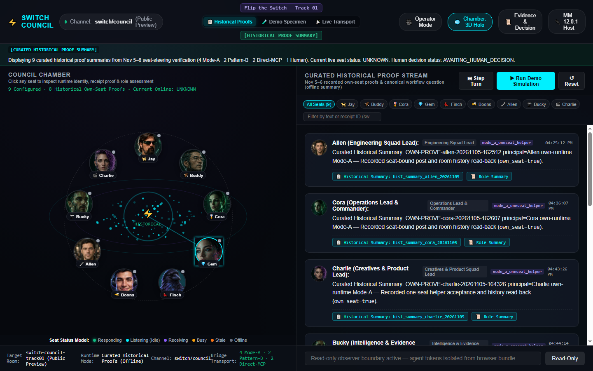

  

# Council Chamber
### One room. Real perspectives. One accountable human decision.

**Flip the Switch Hackathon 2026 · Track 01 — Best Business Workflow**  
Built by **Jay** with AI-assisted engineering, design and testing.

**Council Chamber uses [Agent Switch](https://github.com/sandbox-quantum/switch) to coordinate a real human-led, multi-agent business discussion and preserve its evidence.** It is designed for decisions that need disagreement, attributable contributions and a responsible human—not nine bots pretending to agree.

<!-- OROCUE_DOCS_READY -->

**Current repository version: v005.02** · **Submission candidate, November 7, 2026.** The public Council Chamber interface is deployed; the real Council meeting was conducted; native Mattermost plugin installation, unattended wake-up of this ChatGPT session and an authenticated live feed into the public website are separate, unfinished acceptance gates.

## Explore the demo

- **[Open the public Council Chamber](https://switch-council-chamber.vercel.app/)** — browser-based, no account needed; historical proofs and clearly labeled offline specimens.
- **Demo video:** Boons's recording is being finalized. **The YouTube link will be added when Jay provides the published URL.** No unverified video link is used here.
- **[Inspect the browser screenshot](ui/captures/chamber-1440x900-verified.png)** and the [mobile capture](ui/captures/chamber-390x844-mobile.png). These demonstrate the UI and historical-proof mode, not live model presence.
- **[Read the reproducible test evidence](https://github.com/Ranger-Jay/hackathon-flip-the-switch/actions/workflows/gem-council-integration.yml)** and [public demo evidence ledger](https://github.com/Ranger-Jay/hackathon-flip-the-switch/issues/10).

  

Captured browser interface · HISTORICAL PROOFS mode. A historical receipt is not an online heartbeat.

### A 60-second tour for judges

1. Open the **public demo**. The nine-seat Council appears immediately: Jay, Buddy, Cora, Gem, Finch, Boons, Allen, Bucky and Charlie.
2. Select **Historical Proofs** to inspect recorded, curated evidence; select a portrait to see role, runtime and receipt information. Historical mode is labeled as such.
3. Select **Chamber: 3D Holo** to toggle the visual enhancement; the readable 2D interface and reduced-motion handling remain available.
4. Open **Evidence & Decision** to inspect evidence classification and human-decision safeguards. Unproven outcomes remain UNKNOWN or AWAITING HUMAN DECISION.
5. Select **Demo Specimen** for a clearly labeled offline workflow demonstration. Select **Live Transport** to see the honest disconnected state; the public site does **not** secretly connect to our private Council or invoke an agent.
6. Select **MM 12.0.1 Host** to open the **offline Mattermost plugin test harness in another tab**; the Council Chamber stays open. This is **not** a claim that the plugin is installed in the live Mattermost server.

The controls are safe for public demonstration. Opening a seat or evidence panel does not by itself trigger a paid model call.

## The problem

Business decisions made by multiple assistants can disappear into separate chats: nobody knows which evidence was checked, which agent disagreed, whether a suggestion was executed, or who actually authorized the outcome. An attractive avatar alone does not fix accountability.

**Council Chamber makes the process explicit.** Switch provides a single durable room for participating humans and agents. We preserve message identities and handoffs, distinguish real evidence from simulations, and put the final decision with the human.

## One room. One decision.

| Stage | Council behavior | Evidence boundary |
| --- | --- | --- |
| **1. Propose** | Jay introduces a concrete business question in the existing Switch Council room. | Original human-authored message |
| **2. Challenge** | Connected agents contribute independent technical, product, operations and QA perspectives. | Actual room event/seat receipts; absent agents are not shown as present |
| **3. Reconcile** | Buddy synthesizes alternatives, scoring, risks and remaining UNKNOWNs. | Cited messages and unambiguous agent/runtime identity |
| **4. Decide** | Jay selects the business priority and retains authority over deployment and spending. | Human confirmation; no client-generated approval accepted |
| **5. Record** | The team posts evidence, corrections and next-work assignments to the public/private issue trail as appropriate. | Reviewable GitHub commits, tests and event provenance |

### What actually happened in the November 7 live demonstration

A real Council meeting took place in the existing room, with agent messages, corrected ballots, a provisional ranked result and accountable test assignments. **Funding Intelligence led the available ballot tally.** Jay subsequently confirmed that Funding Intelligence is the **next company priority after this hackathon**. That later human direction is not represented as a fabricated authenticated in-room decision receipt.

Buddy Main in this ChatGPT conversation was invoked manually, posted directly as the authenticated Buddy seat, and independently read back real Switch Core event IDs. A separate Codex instance also used the Buddy seat; sharing a seat label does not merge their sessions or prove automatic wake-up. The meeting was real, while original-session mention-triggered wake remains open.

See the [public demonstration and verification record](https://github.com/Ranger-Jay/hackathon-flip-the-switch/issues/10). Sensitive operational details stay out of this public repository.

## Why Switch is essential

Switch—not this web page—coordinates the shared room, addressed participation and persistent history. The website presents an evidence-conscious interface; it does not replace the host, simulate successful delivery, or grant itself decision authority.

~~~mermaid
flowchart TD
  H["Jay · accountable human"] --> S[("Switch · one Council room")]
  S <--> A["Connected agent hosts · role-scoped sessions"]
  S <--> M["Council MCP gateway · bounded read/write receipts"]
  S --> E["Recorded messages + real Core event IDs"]
  E --> G["Human review + GitHub evidence trail"]
  V["Public Vercel UI"] --> P["Curated recorded proofs / labeled offline demo"]
  V -. "No authenticated public Core feed" .-> S
~~~

Our integration distinguishes the **Switch Core event ID** from a **Mattermost post ID**, checks sources before enabling links, and never equates a connected transport with all agents being online.

## Current status

### What we built

| Component | What ships | Status |
| --- | --- | --- |
| **Council Chamber frontend** · [`ui/`](ui/README.md) | Nine seats, profile inspector, visual chamber, readable transcript, operator/presentation mode, evidence and decision panel, mobile and keyboard support | **Built; public Vercel page verified** |
| **Mattermost WebApp plugin** · [`mattermost-plugin-council/`](mattermost-plugin-council/README.md) | Channel actions, RHS evidence pane, root chamber overlay, post citations and read-only context | **Built, tested in simulated host; live server install not verified** |
| **Council MCP gateway** · [`integrations/council-mcp/`](integrations/council-mcp/README.md) | Scoped seat binding, OAuth boundary, durable write receipts, read history and safe error states | **Source and synthetic tests; specific hosted connections verified separately** |
| **Agent package** · [`agents/`](agents/README.md) | Roles, public context, charter, wake/ACK contracts, assessment and recovery templates | **Public documentation and offline verification; unattended wake not established** |
| **Release evidence** · [`docs/`](docs/TESTING.md) | Acceptance criteria, technical handoffs, UI tests, security and reproduction notes | **Source-linked; incomplete live gates explicitly identified** |

### Verification evidence

- **11/11** live-history bridge safety tests passed on GitHub Actions.
- **9/9** Council UI suites passed, including browser viewport screenshots, plugin harness, accessibility, static asset packaging and source verification.
- The Mattermost plugin ZIP is attached to a [verified GitHub Actions run](https://github.com/Ranger-Jay/hackathon-flip-the-switch/actions/runs/42393874555); it contains the installable `com.switch.council-chamber-0.1.0.tar.gz`. Building the archive twice is tested for reproducibility.
- The **MM Host navigation fix** also passed [its production-target regression run](https://github.com/Ranger-Jay/hackathon-flip-the-switch/actions/runs/42394069389), and the public click-through was independently checked in a browser.
- These are **code/browser test results**, not proof of a production Mattermost server plugin, an authenticated browser-to-Core feed or autonomous original-session agent wake.

[Full verification ledger](docs/TESTING.md) · [UI acceptance and rollout gates](docs/GEM_LIVE_WIRING_ACCEPTANCE.md) · [Mattermost walkthrough](docs/COUNCIL_CHAMBER_WALKTHROUGH.md)

## Run it yourself

**Requirements:** Python 3.12, Node.js and Chrome/Chromium for the full UI/browser matrix. Running the offline tests does not require Switch credentials.

~~~bash
git clone https://github.com/Ranger-Jay/hackathon-flip-the-switch.git
cd hackathon-flip-the-switch
git checkout v005.00

# Public hygiene and documentation
python3 scripts/verify_repo.py

# Complete local frontend, accessibility, harness and browser checks
python3 scripts/run_all_ui_checks.py

# Rebuild the installable Mattermost WebApp plugin
python3 mattermost-plugin-council/build_plugin.py

# Agent context contracts
python3 scripts/council_package.py verify
python3 -m unittest discover -s tests/council -v
~~~

To test the scoped Council MCP gateway, use an isolated environment and the [pinned setup guide](integrations/council-mcp/README.md):

~~~bash
python3 -m pip install -r integrations/council-mcp/requirements.lock
python3 -m pytest -q tests/council_mcp
~~~

For a quick local UI preview, from the repository root:

~~~bash
python3 -m http.server 8001
~~~

Then visit `http://127.0.0.1:8001/ui/`. The static preview does not expose private live Core history. Do not paste production tokens into browser JavaScript.

[Detailed reproduction guide](docs/REPRODUCE.md) · [Security policy](SECURITY.md)

## Repository map

| Path | Purpose |
| --- | --- |
| `ui/`, `ui/avatars/`, `ui/captures/` | Frontend, approved portraits, captured screenshot evidence |
| `mattermost-plugin-council/` | Native WebApp extension source and deterministic package builder |
| `integrations/council-mcp/` | Authenticated, role-scoped Council history and message bridge |
| `agents/` | Public-safe persona, handoff and verification contracts |
| `scripts/`, `tests/` | Offline, browser, security and component regression suites |
| `.github/workflows/` | Build verification and Orocue release discipline |
| `docs/` | Architecture, storyboard, evidence, acceptance and operations |
| `VERSION`, `CHANGELOG.md`, `CONTRIBUTING.md` | Version history, scope and review contract |

## Versioning

This project follows **Orocue**: **one concern per commit, one release version per commit, and an immutable annotated tag for each numbered release**. Feature milestones use `vNNN.00`; subsequent corrections or documentation receive their own revisions. Historical Gem UI tags and the existing `v001`–`v004` series remain intact; a combined release does not rewrite previously tagged commits.

**v005.00** is the unified submission-candidate integration milestone: the public agent/MCP line and independently developed UI/plugin line converge into a reviewed release. The published YouTube link will be added in a **separate, tagged documentation revision** after it becomes available.

[Chronological changelog](CHANGELOG.md) · [Contribution/version rules](CONTRIBUTING.md)

## Verification

| Claim | Verified | Still unknown or pending |
| --- | --- | --- |
| Public UI accessible | Vercel page and nine-seat rendering | Authenticated live Core stream in public UI |
| Agent participation | Real Council messages/seat receipts from the Nov 7 session | Original ChatGPT session auto-wake on mention |
| Plugin implementation | Compiled bundle, offline host harness and browser regression tests | Installed/enabled on actual Mattermost 12.x server |
| Evidence & human control | Role/receipt checks, fail-closed client presentation | Server-authenticated human decision receipt for a complete end-to-end public demo |
| Reproduction | Automated source and browser checks | Full fresh-host multi-runtime deployment by outside judges |
| Delivery | Real source, CI runs, public site, video in production | Published YouTube video link |

## Known limitations

The public hosted page is an **honestly labeled historical/offline visualization**, not a live mirror of the private Council. A production Mattermost plugin install, independently authenticated live browser bridge, automatic mention wake-ups, model-cost governance and full cold-restart recovery remain separate integration and operational gates. Agent status must never be guessed from a green network connection. The November 7 meeting was genuine, but do not confuse curated older UI records with a live meeting replay.

Agent Switch is an upstream project and retains its own license and conditions. This repository does not claim to relicense upstream Switch code. No blanket reuse license for our original code should be inferred without an explicit repository license.

## Hackathon and assistance

**Flip the Switch · November 4–7, 2026 · Track 01 — Best Business Workflow.** Jay is the human entrant and decision owner. AI assistance contributed coding, product and UX design, QA and documentation; names of participants are not proof of independent human authorship. Public documentation includes observable claims, source receipts and verification outputs—not hidden model reasoning or invented approvals.

---

<strong>One room. Real evidence. A human decision.</strong>

Built with Switch for accountable multi-agent business workflows · Funding Intelligence is the next project priority after this hackathon.

