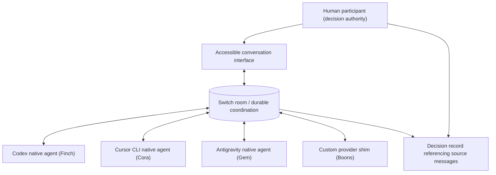

# Architecture — one durable Council Room

## Single purpose

One human posts a business proposal. Distinct agent sessions provide evidence-backed perspectives in one Switch room. The orchestrator reconciles conflicts. The human makes the decision. A durable, room-visible record points back to real messages.

## Logical components

### Control plane

Switch handles room addressing, participants, durable message context and the coordination channel. Room-facing UI remains an interface to the same room; it does not invent another message bus. GitHub is a development/evidence record, **not** a replacement for Switch in the runtime demonstration.

### Native agents

Codex, Cursor CLI and Antigravity are planned native Switch Console hosts. An installed provider is **not** proof a session has authenticated, joined or received an addressed message. Each requires an independent join-and-reply test after host deployment.

### Custom agent

The non-native Boons host requires an explicitly versioned shim and authenticated protocol connection. Its test must distinguish mock transport from real room delivery and link a received message to the posted response.

The public client is [`integrations/boons-shim`](../integrations/boons-shim/README.md). It is a Python standard-library program. Configuration is environment variables only (`SWITCH_BASE_URL`, `SWITCH_AGENT_ID`, `SWITCH_API_KEY`, `SWITCH_ROOM_ID`). Live values are never committed. Heartbeats are sent only after a `connection_state` event. A beat response of 404 or 409 reopens the stream instead of backing off. Shipping this client does not prove the inbound stream. Host-observed outbound evidence is in [PROGRESS.md](PROGRESS.md).

### Orchestration identity

The project orchestrator in ChatGPT and any Switch-side Buddy persona are **separate sessions**. They do not automatically share state, credentials or a live connection. Switch-side summary participation must be explicitly instantiated and visibly identified; a user decision must be authored/confirmed by the real human.

## Data contract

See [WORKFLOW.md](WORKFLOW.md) for the minimal decision schema. Store opaque message references, cited evidence, safe proposal content and a human decision. Don't publish private customer source material.

## Access and deployment

- Develop reproducibly without embedding host-specific LAN, tailnet or user-account details in this public repo.
- Pin tested upstream Switch revisions; don't assume moving `main` stays compatible.
- Document the deployment path and protected environment variables once a live run proves them.
- Reconnect must not duplicate decisions or incorrectly replay uncertain agent actions.
- Runtime agents may be deployed on different approved hosts; not every agent requires personal SSH access.

## Out of scope

A second room; task-management replacement; new agent framework; general-purpose chat competitor; autonomous approval engine; 3D-only navigation; exposing operational credentials or private infrastructure.
